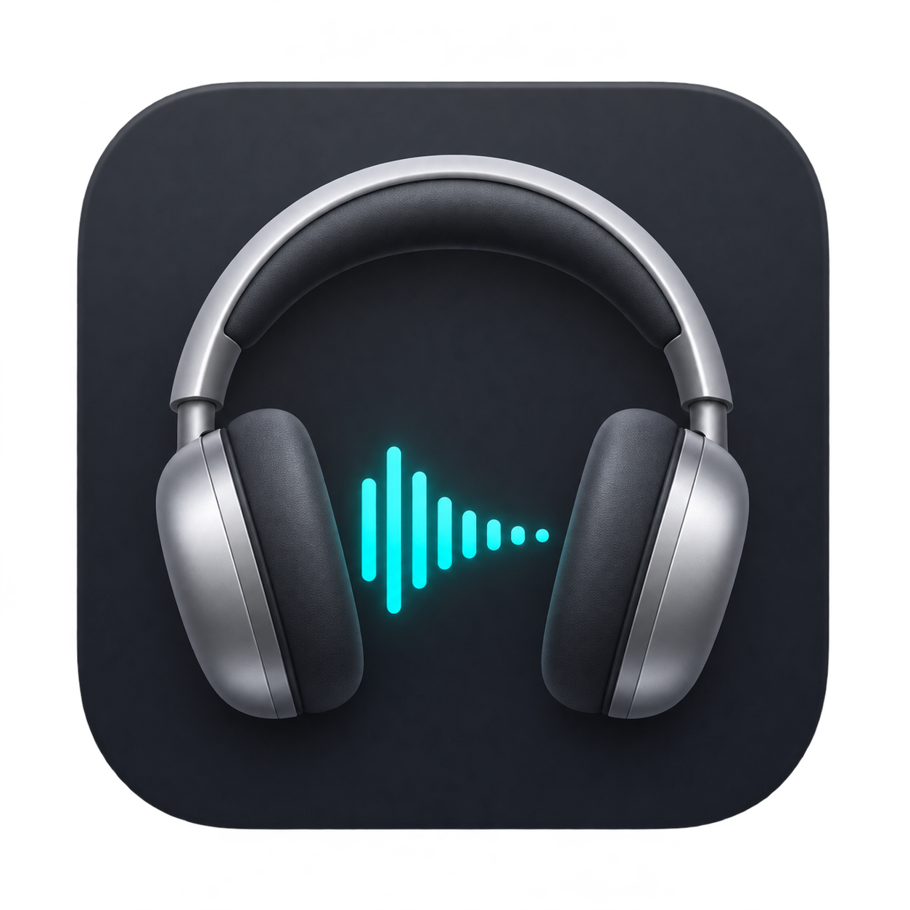

# Atom Control



**[Português (Brasil)](#português-brasil)** · **[English](#english)** · **[Español](#español)**

---

## Português (Brasil)

Controle o cancelamento de ruído do fone **EDIFIER Atom Max** pela barra de menus do Mac, sem abrir o aplicativo do celular.

- Quatro modos: **ANC forte**, **ANC fraco**, **Som ambiente** e **Desativado**.
- Mostra bateria e o modo atual; o ícone na barra muda conforme o modo.
- Leve: sem janela, sem ícone no Dock, sem internet e sem coleta de dados.
- Em português, inglês ou espanhol, conforme o idioma do Mac.

**Requisitos:** Mac com macOS 13 (Ventura) ou posterior.

### Instalar com um agente de IA (recomendado)

Abra um agente de IA que trabalhe no seu Mac (Claude Code, Codex, Cursor, Gemini CLI etc.) e cole:

> Baixe https://github.com/xandroalmeida/edifier-atom-max, siga as instruções do arquivo AGENTS.md para compilar e instalar o Atom Control no meu Mac e me explique o que fazer depois.

O agente confere o Mac, compila e instala o app em **Aplicativos**. Se o macOS pedir para instalar as "ferramentas de linha de comando" ou pedir sua senha, aceite.

### Instalar manualmente

No **Terminal**:

```sh
xcode-select --install   # só na primeira vez; clique em Instalar e aguarde
git clone https://github.com/xandroalmeida/edifier-atom-max.git
cd edifier-atom-max
zsh scripts/install.sh
```

### Usar

1. Ligue o Atom Max e deixe o Bluetooth do Mac ativado.
2. Clique no ícone de fone na barra de menus (canto superior direito).
3. Quando o macOS perguntar, permita o acesso ao Bluetooth.
4. Escolha o modo de ruído. Para abrir o app automaticamente, marque **Iniciar com o Mac**.

O app só controla o cancelamento de ruído; o áudio continua sendo escolhido nos ajustes de Som/Bluetooth do Mac.

### Problemas comuns

- **Fone não encontrado:** feche o app Edifier ConneX no celular e no Mac, aproxime o fone e clique em **Conectar ao fone**. Se persistir, desligue e ligue o fone.
- **Permissão negada:** Ajustes do Sistema → Privacidade e Segurança → Bluetooth → ative Atom Control.
- **Cabo USB-C:** o Atom Max desliga o Bluetooth quando usado com cabo; o app precisa do Bluetooth.
- **Desinstalar:** `zsh scripts/install.sh --uninstall` na pasta do projeto.

---

## English

Control the noise cancellation of your **EDIFIER Atom Max** headphones from the Mac menu bar, without the phone app.

- Four modes: **Strong ANC**, **Light ANC**, **Ambient sound** and **Off**.
- Shows battery and current mode; the menu-bar icon changes with the mode.
- Lightweight: no window, no Dock icon, no internet, no data collection.
- In English, Portuguese or Spanish, following your Mac's language.

**Requirements:** a Mac running macOS 13 (Ventura) or later.

### Install with an AI agent (recommended)

Open an AI agent that works on your Mac (Claude Code, Codex, Cursor, Gemini CLI, etc.) and paste:

> Download https://github.com/xandroalmeida/edifier-atom-max, follow the instructions in AGENTS.md to build and install Atom Control on my Mac, and tell me what to do next.

The agent checks your Mac, builds the app and installs it in **Applications**. If macOS asks to install the "command line developer tools" or asks for your password, accept.

### Install manually

In **Terminal**:

```sh
xcode-select --install   # first time only; click Install and wait
git clone https://github.com/xandroalmeida/edifier-atom-max.git
cd edifier-atom-max
zsh scripts/install.sh
```

### Use

1. Turn on the Atom Max and keep Bluetooth on your Mac enabled.
2. Click the headphones icon in the menu bar (top right).
3. When macOS asks, allow Bluetooth access.
4. Pick a noise mode. To start the app automatically, check **Launch at login**.

The app only controls noise cancellation; audio output is still chosen in the Mac's Sound/Bluetooth settings.

### Troubleshooting

- **Headphones not found:** close the Edifier ConneX app on your phone and Mac, bring the headphones closer and click **Connect to headphones**. If it persists, turn the headphones off and on.
- **Permission denied:** System Settings → Privacy & Security → Bluetooth → enable Atom Control.
- **USB-C cable:** the Atom Max turns Bluetooth off when used with a cable; the app needs Bluetooth.
- **Uninstall:** run `zsh scripts/install.sh --uninstall` in the project folder.

---

## Español

Controla la cancelación de ruido de tus auriculares **EDIFIER Atom Max** desde la barra de menús del Mac, sin la app del móvil.

- Cuatro modos: **ANC fuerte**, **ANC suave**, **Sonido ambiente** y **Desactivado**.
- Muestra la batería y el modo actual; el icono de la barra cambia según el modo.
- Ligera: sin ventana, sin icono en el Dock, sin internet y sin recopilar datos.
- En español, portugués o inglés, según el idioma del Mac.

**Requisitos:** un Mac con macOS 13 (Ventura) o posterior.

### Instalar con un agente de IA (recomendado)

Abre un agente de IA que trabaje en tu Mac (Claude Code, Codex, Cursor, Gemini CLI, etc.) y pega:

> Descarga https://github.com/xandroalmeida/edifier-atom-max, sigue las instrucciones de AGENTS.md para compilar e instalar Atom Control en mi Mac y explícame qué hacer después.

El agente revisa tu Mac, compila la app y la instala en **Aplicaciones**. Si macOS pide instalar las "herramientas de línea de comandos" o pide tu contraseña, acepta.

### Instalar manualmente

En **Terminal**:

```sh
xcode-select --install   # solo la primera vez; haz clic en Instalar y espera
git clone https://github.com/xandroalmeida/edifier-atom-max.git
cd edifier-atom-max
zsh scripts/install.sh
```

### Uso

1. Enciende los Atom Max y mantén activado el Bluetooth del Mac.
2. Haz clic en el icono de auriculares de la barra de menús (arriba a la derecha).
3. Cuando macOS lo pida, permite el acceso a Bluetooth.
4. Elige el modo de ruido. Para abrir la app automáticamente, marca **Abrir al iniciar sesión**.

La app solo controla la cancelación de ruido; la salida de audio se sigue eligiendo en los ajustes de Sonido/Bluetooth del Mac.

### Problemas frecuentes

- **Auriculares no encontrados:** cierra la app Edifier ConneX en el móvil y en el Mac, acerca los auriculares y haz clic en **Conectar a los auriculares**. Si persiste, apágalos y vuelve a encenderlos.
- **Permiso denegado:** Ajustes del Sistema → Privacidad y seguridad → Bluetooth → activa Atom Control.
- **Cable USB-C:** los Atom Max apagan el Bluetooth cuando se usan con cable; la app necesita Bluetooth.
- **Desinstalar:** ejecuta `zsh scripts/install.sh --uninstall` en la carpeta del proyecto.

---

Documentação técnica / Technical documentation / Documentación técnica: [docs/documentacao-tecnica.md](docs/documentacao-tecnica.md)
